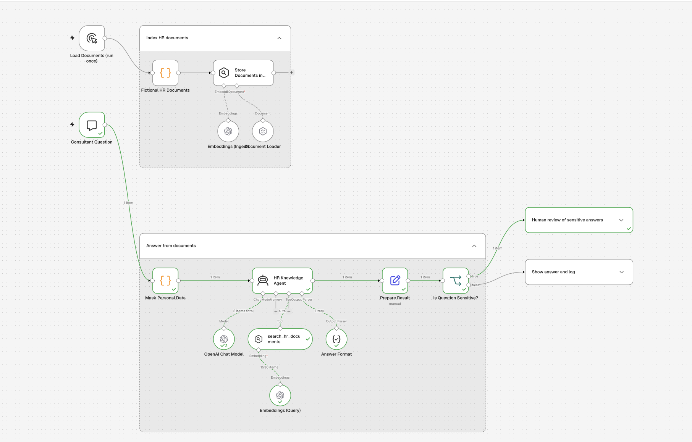
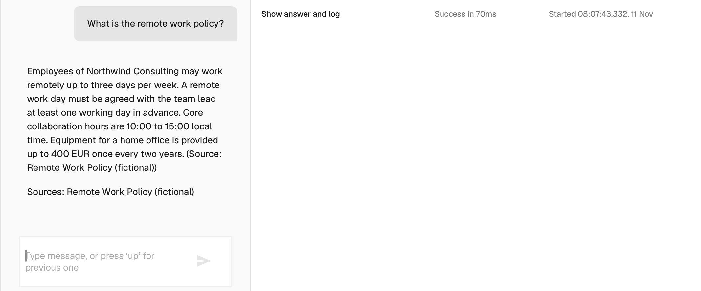
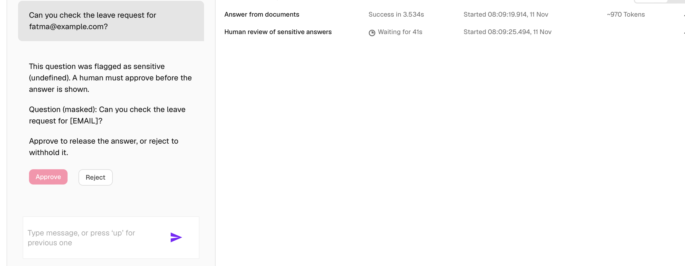

# HR Consulting Assistant

An AI-powered HR assistant built with **n8n, OpenAI, and Retrieval-Augmented Generation (RAG)**. It answers HR-related questions using a predefined document library, protects personal information, and routes sensitive questions through a human approval process.

## Project Overview

The HR Consulting Assistant is designed to help employees and HR teams access internal HR information more efficiently.

Instead of generating answers from general knowledge, the assistant retrieves relevant information from a dedicated HR document library. It provides source-based answers and includes a human-in-the-loop mechanism for sensitive topics.

## Workflow Overview

The complete n8n workflow, including document ingestion, question answering, sensitive-question routing, human review, and logging.

### 1. HR Document Ingestion

Shows the five sample HR documents and the nodes used to load them, generate embeddings, and store them in the in-memory vector store.

### 2. HR Knowledge Agent

Shows the HR Knowledge Agent configuration, its OpenAI chat model, the `search_hr_documents` retrieval tool, and the structured answer format.

### 3. Chatbot – Normal Question

Example of a non-sensitive employee question and the assistant's answer grounded in the HR document library, including its source.

### 4. Sensitive Question Detection and Human Review

Shows the sensitive-question branch and the human approval step. Capture the review request with a test question, then show the approval or rejection outcome if possible.

### 5. Interaction Logging

Shows the `hr_assistant_log` Data Table with an example interaction, including the masked question, answer, sources, sensitive flag, and human decision.

### 6. Fallback – No Relevant Information

Example of a question that is not covered by the HR documents. The assistant should respond that it does not know rather than inventing an answer.

## Key Features

- **Document-based answers:** Retrieves information from a collection of fictional HR documents.
- **RAG architecture:** Uses embeddings and an in-memory vector store to retrieve relevant passages.
- **Source citations:** Includes the names of the documents used to generate each answer.
- **Personal data masking:** Detects and masks email addresses and phone numbers before sending questions to the AI agent.
- **Sensitive-question detection:** Flags questions related to health, personal rights, and identifiable individuals.
- **Human approval:** Requires a reviewer to approve or reject sensitive answers before they are displayed.
- **Interaction logging:** Records masked questions, answers, sources, sensitivity status, and human decisions.

## HR Knowledge Base

The workflow includes five fictional HR documents:

| Document | Main topic |
|---|---|
| Remote Work Policy | Remote work rules and equipment |
| Leave Policy | Annual leave and sick leave |
| Parental Leave Guide | Parental leave conditions |
| Code of Conduct and Grievance Procedure | Workplace conduct and complaints |
| Learning and Development Budget | Training budget and paid training days |

All documents contain fictional sample information and are intended for demonstration purposes.

## Workflow Architecture

The workflow is organized into four main stages:

### 1. Index HR Documents

- Loads the fictional HR documents.
- Generates embeddings using OpenAI.
- Stores documents and their source metadata in an In-Memory Vector Store.

### 2. Process and Answer Questions

- Receives questions through the n8n chat interface.
- Masks email addresses and phone numbers.
- Detects potentially sensitive topics.
- Uses the HR Knowledge Agent to retrieve relevant passages.
- Generates structured answers with source references.

### 3. Human Review

For sensitive questions:
- Sends the masked question and review information to a human reviewer.
- Waits for approval or rejection.
- Displays the answer only if approved.
- Withholds the answer if rejected.

Non-sensitive answers are displayed directly.

### 4. Logging and Traceability

The workflow records interactions in the `hr_assistant_log` data table, including:
- Session ID
- Masked question
- Answer
- Sources
- Sensitive status
- Human decision (`approved`, `rejected`, or `not_required`)

## Technologies Used

- **n8n** – Workflow automation and orchestration
- **OpenAI** – Language model and embeddings
- **AI Agent** – Question answering and tool usage
- **Retrieval-Augmented Generation (RAG)** – Document retrieval and grounded responses
- **In-Memory Vector Store** – Document storage and semantic search
- **JavaScript** – Data masking and sensitive-question detection
- **n8n Data Tables** – Interaction logging

## Getting Started

### Prerequisites

- An n8n instance
- OpenAI API credentials configured in n8n
- The exported workflow JSON file

### Installation

1. Download `HR Consulting Assistant.json` from this repository.
2. Open your n8n instance.
3. Import the JSON workflow.
4. Configure your OpenAI credentials for the chat model and embeddings nodes.
5. Ensure the `hr_assistant_log` Data Table is available and correctly configured.
6. Run the **Load Documents (run once)** workflow to populate the vector store.
7. Publish the workflow and enable the chat interface.
8. Test the assistant with HR-related questions.

**Note:** The document store is in memory. Run the document-loading workflow again when the vector store needs to be repopulated, such as after an instance restart.

## Example Questions

- How many annual leave days do employees receive?
- What is the remote work policy?
- What is the parental leave duration?
- What is the annual learning budget?

Sensitive questions may require human approval before an answer is displayed.

## Limitations

- The HR documents contain fictional sample policies.
- The vector store is in memory rather than persistent storage.
- Sensitive-question detection relies on predefined keyword patterns and regular expressions; it is not a complete privacy or compliance solution.
- Human review is required for questions flagged by the workflow.
- The assistant should not replace professional HR, legal, or medical advice.

## Future Improvements

- Connect a persistent vector database.
- Expand the HR document library.
- Improve sensitive-topic detection.
- Add authentication and role-based access.
- Build an analytics dashboard for interaction monitoring.

## Repository

[View the workflow on GitHub](https://github.com/BellaghFatmaAzahra/HRConsultingAssistant)

---

*This project was developed as a practical demonstration of AI workflow automation, document-based question answering, data protection, and human-in-the-loop decision-making.*
